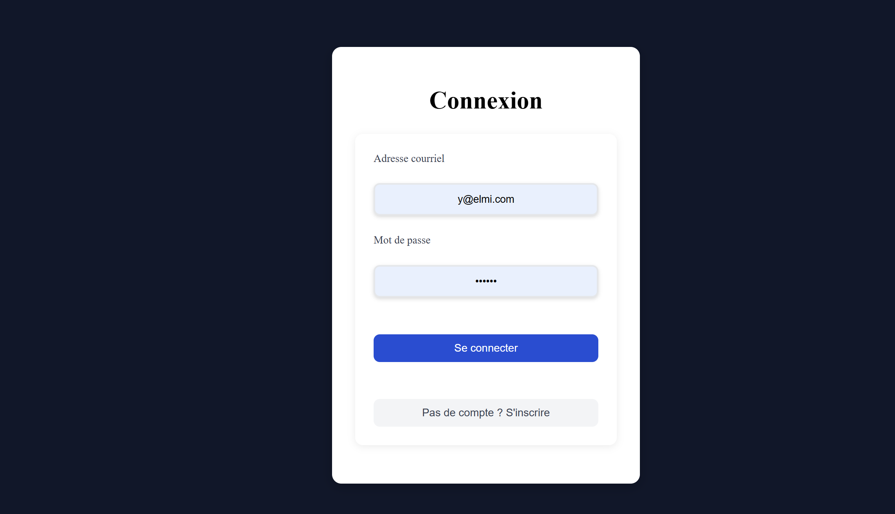
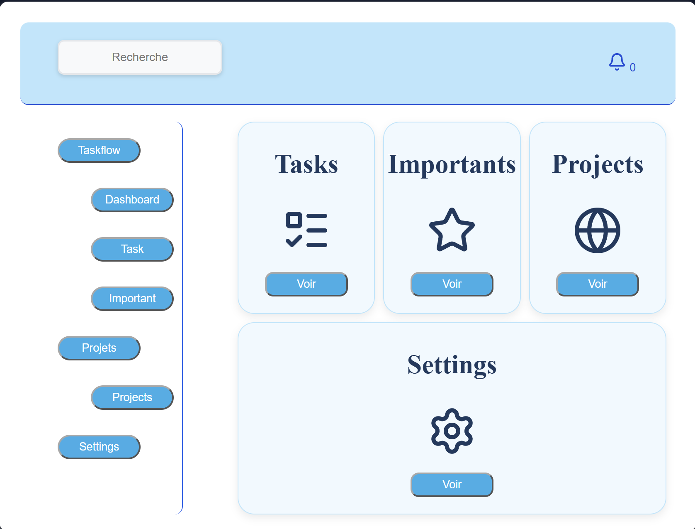

# dashApi : Dashboard de gestion de projets et de tâches

Application web full-stack où chaque utilisateur se connecte et gère **ses propres projets et tâches**.

## Fonctionnalités

- Inscription et connexion des utilisateurs (mots de passe hachés, jamais renvoyés par l'API)
- Chaque utilisateur ne voit que ses propres projets et tâches (liés par `userId`)
- Création, modification et suppression de projets et de tâches
- Marquage des tâches importantes et page dédiée
- Notifications générées automatiquement à chaque création, modification ou suppression
- Barre de recherche pour filtrer les tâches et les projets

## Captures d'écran




## Stack technique

| Partie | Technologies |
|---|---|
| Frontend | React, Vite, JavaScript |
| Backend | ASP.NET Core Web API (C#), [.NET 9] |
| Base de données | [PostgreSQL] avec Entity Framework Core |
| Authentification | [hachage du mot de passe ; ajoute JWT si c'est le cas] |

## Structure du projet

```
dashApi/
├── (backend ASP.NET Core : contrôleurs, modèles, migrations)
├── frontend/   (application React)
└── README.md
```

## Points de conception

- **Séparation des responsabilités** : les contrôleurs reçoivent les requêtes, la logique et l'accès aux données restent à part.
- **Sécurité** : mots de passe hachés, aucun mot de passe renvoyé dans les réponses, accès aux données limité à l'utilisateur connecté.
- [Si tu as utilisé un patron de conception (ex. Observateur pour les notifications), explique-le ici en 2 lignes.]

## Installation

### Prérequis

- [.NET SDK 9]
- Node.js (18 ou plus)
- [PostgreSQL]

### 1. Configurer les secrets

Les vrais secrets ne sont pas dans le dépôt. Copie le fichier d'exemple et remplis tes valeurs :

```bash
cp appsettings.Example.json appsettings.Development.json
```

Modifie la chaîne de connexion [et la clé secrète] dans `appsettings.Development.json`. Ce fichier est ignoré par Git.

### 2. Lancer le backend

```bash
dotnet restore
dotnet ef database update
dotnet run
```

L'API démarre sur [https://localhost:7038].

### 3. Lancer le frontend

```bash
cd frontend
npm install
npm run dev
```

L'application est disponible sur [http://localhost:5173].

## Améliorations prévues

- [Page d'inscription / Settings / tests unitaires : liste ce qui reste à faire]

## Auteur

Ayanleh Osman, étudiant en informatique à l'UQTR :https://www.linkedin.com/in/ayanleh-osman-55b7b939b/
